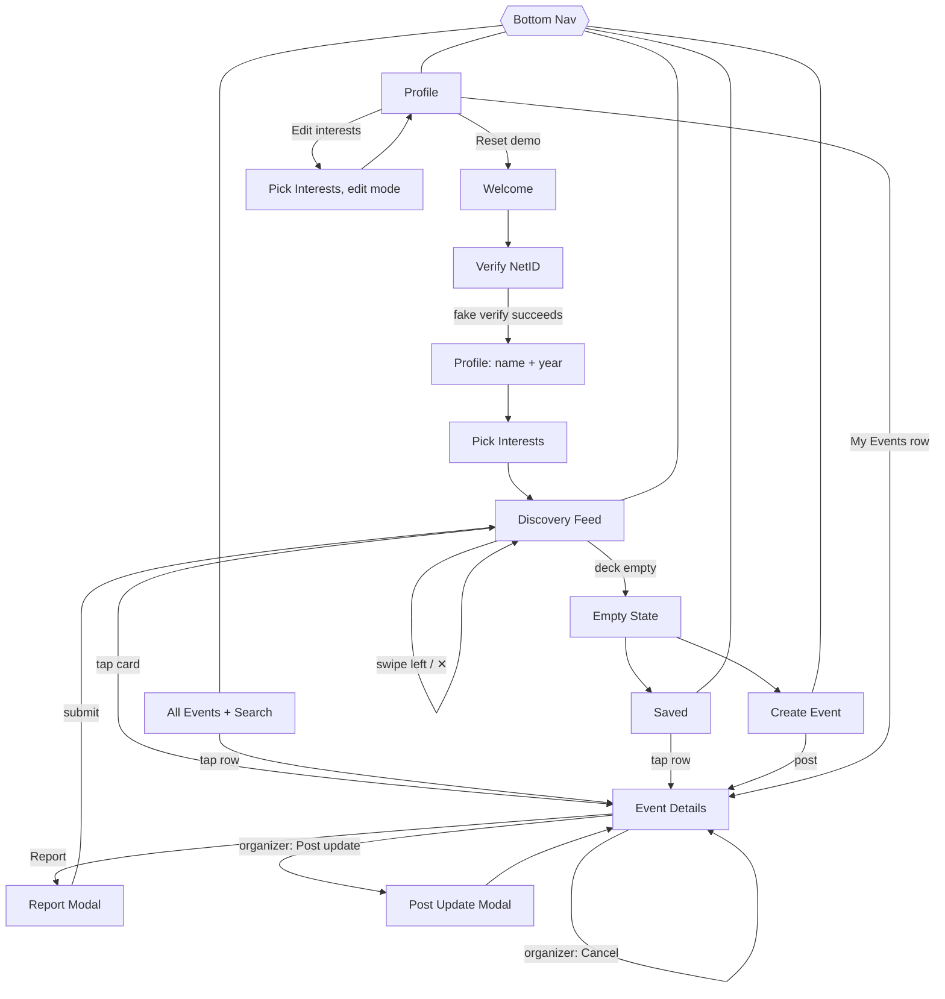

# App Flow: Campus Event Discovery Prototype (v0.1)

Companion to `PRD.md` and `TRD.md`. This document describes every screen, what's on it, and where each action leads. Visuals are intentionally basic.

## 1. Flow Map

## 2. Screens

### 2.1 Welcome `/welcome`
- **Shows:** app name, one-line pitch ("Find low-key things to do at Cornell, tonight."), a **Get started** button.
- **Get started** goes to Verify NetID.

### 2.2 Verify NetID `/onboarding/verify`
- **Shows:** NetID input (with `@cornell.edu` suffix label), **Verify** button, and the note "Only verified Cornell students can see event locations."
- **Verify:**
  - Invalid format shows the inline error "Enter a valid NetID (e.g., abc123)."
  - Valid format shows a "Verifying with Cornell…" spinner for about 1.2 s, then a check mark, then goes to Profile.
- **Back** returns to Welcome.

### 2.3 Profile Setup `/onboarding/profile`
- **Shows:** Display name input and class year picker (First-year, Sophomore, Junior, Senior, Transfer).
- **Continue** is disabled until both are filled, then goes to Pick Interests.

### 2.4 Pick Interests `/onboarding/interests`
- **Shows:** 7 category tiles (emoji and label), multi-select, and the helper text "You'll still see other stuff too, so you can discover something new."
- **Continue** is disabled until at least one tile is selected. It saves the user and goes to the Feed.
- **Edit mode** (opened from Profile) has a **Save** button that returns to Profile.

### 2.5 Discovery Feed `/feed` (home)
- **Header:** "Discover" title and a horizontally scrolling row of category chips ("All" plus 7 categories).
- **Card** contents:
  - Category emoji and label. Events outside the user's interests also show a "✨ Something new" tag.
  - Title
  - 🕒 "Happening now" or a relative time ("Today · 7:00 PM", "Sat · 2:00 PM")
  - 📍 Location name
  - 👤 Organizer name with a `Student` or `Club` pill
  - "6 spots left" if capacity is set, otherwise "12 interested"
- **Interactions:**
  - Drag right past the threshold, or tap ✓: the card flies right, the event is saved, and a toast reads "Saved. Find it in Saved." with an **Undo** option.
  - Drag left, or tap ✕: the card flies left and the event is passed.
  - Tap the card opens Event Details.
  - Tap a chip refilters the deck immediately.
- **Empty state** ("You're all caught up 🎉"): buttons for **See saved**, **Show passed events again** (runs resetPasses), and **Host something**. If a category filter is active, add the line "Try 'All' categories."

### 2.6 Event Details `/events/:id`
- **Top:** back arrow and a ⋯ menu containing Report.
- **Body**, always in this order:
  1. Category label and title
  2. Organizer with a Student/Club pill
  3. 🕒 Date and time range, with a "Happening now" badge if applicable
  4. 📍 Location name and location note. For an unverified user this would show 🔒 "Verify to see location," though it won't appear in the prototype.
  5. About (description)
  6. What to know (participation details)
  7. Capacity ("10 spots · 4 interested")
  8. ♿ Accessibility
  9. **Updates** list (type icon, message, "2h ago"). If there are none, show "No updates yet."
- **Bottom bar (attendee):** a **I'm interested** / **✓ Saved** toggle.
- **Bottom bar (organizer):** **Post update** and **Cancel event** buttons. Cancel asks for confirmation, then marks the event cancelled and adds the update "This event was cancelled."
- **Cancelled event:** a red banner at the top, and the interest toggle is disabled.
- Opening this screen marks the event's updates as seen, which clears the "New update" badge.

### 2.7 Post Update (modal, organizer only)
- **Type selector:** Time change, Location change, General note.
  - **Time change** shows new start and end pickers, prefilled with the current values.
  - **Location change** shows new location name and note fields, prefilled.
- **Message** is up to 280 characters and is auto-suggested for time and location changes (e.g., "Moved from 7 PM to 8 PM").
- **Post** updates the event, adds the update to the list, closes the modal, and shows the toast "Update sent to interested students (simulated)."

### 2.8 Report (modal)
- Radio list of reasons (Inappropriate, Misleading or spam, Unsafe, Not a Cornell student event, Other) with an optional note.
- **Submit** shows the message "Thanks, we'll review this. You won't see this event anymore," then returns to the Feed.

### 2.9 Create Event `/create`
- **Posting as:** Me (Student) or A club (reveals a club name field).
- **Fields:** Title, Category (chips), Description, Date, Start time, End time, Location name, Location note (optional), Capacity (toggle between "No limit" and a number), Participation details (optional), Accessibility info (optional, with the placeholder "e.g., wheelchair accessible, step-free entrance").
- **Policy box:** "Hosting on campus? Follow Cornell's space reservation and student conduct policies." It has a link (placeholder `#`) and a required checkbox reading "I understand."
- **Post event** validates the form, showing inline errors and scrolling to the first one. On success it shows the toast "Your event is live" and goes to that event's Event Details page.
- **Cancel** or back asks "Discard this event?" if any field has been filled.

### 2.10 Saved `/saved`
- **Tabs:** Upcoming (default) and Past.
- **Rows:** title, time, location, and badges for "New update" and "Cancelled" where applicable.
- Swipe a row or open its ⋯ menu to **Remove**.
- **Empty state:** "Nothing saved yet. Swipe right on something you like," with a button that opens the Feed.

### 2.11 All Events `/events` (P1)
- Search input and category chips.
- List grouped by day ("Happening now," "Today," "Tomorrow," "Sat Oct 31"). Tapping a row opens Event Details.
- When nothing matches: "No events match. Try another word or category."

### 2.12 Profile `/profile`
- Name, NetID, class year, and a **Verified Cornell student ✓** badge.
- **My interests** with an Edit link that opens Pick Interests in edit mode.
- **My Events:** a list of events the user hosted, each with its interested count. Tapping a row opens Event Details.
- **Demo tools:** **Reset demo**, which asks for confirmation, then clears storage and returns to Welcome.

## 3. Usability Test Task Paths

| Task | Expected path | Success criteria |
|---|---|---|
| 1. Find something tonight matching your interests and save it | Feed → (optional chip) → swipe right or ✓ | Saved within XX s |
| 2. Post pickup soccer on the Arts Quad, Saturday 2 PM, 10 people | ＋ Create → fill form → check policy box → Post | Event posted without help |
| 3. Check whether your saved event changed | Saved → row with "New update" badge → Details → Updates | Participant correctly states the change |

**For task 3:** seed data includes at least one event with a recent update, so it shows up in Saved when the participant swipes right on it.

## 4. Global Patterns

- **Toasts** appear at the bottom for 3 s. The Save toast includes Undo.
- **Confirmations** are required for destructive actions: discard a draft, cancel an event, reset the demo.
- **Times** always display in local time using relative labels.
- **Bottom nav** appears on Feed, Events, Saved, and Profile. It is hidden during onboarding, Create, and modals.
